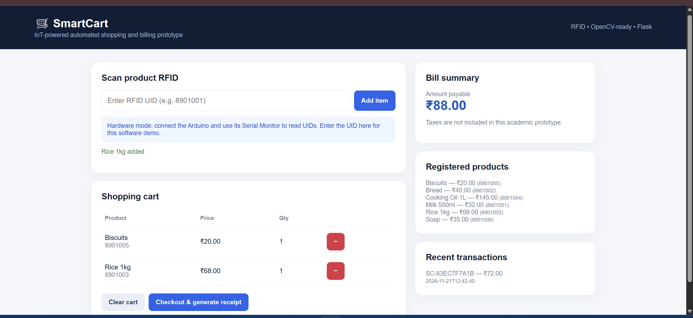
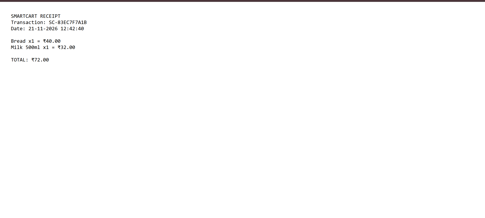
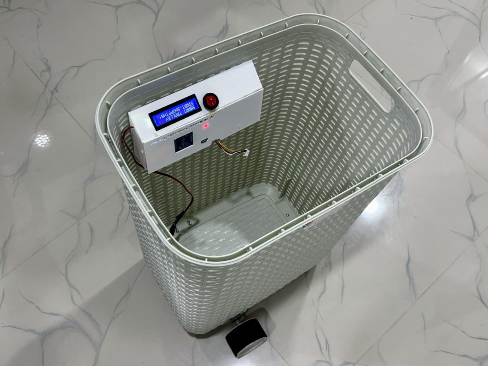
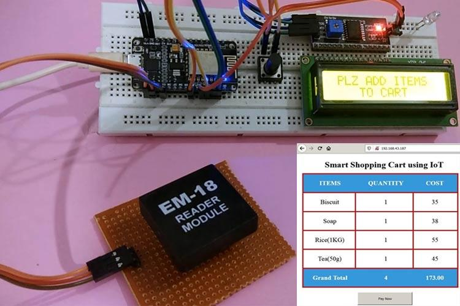
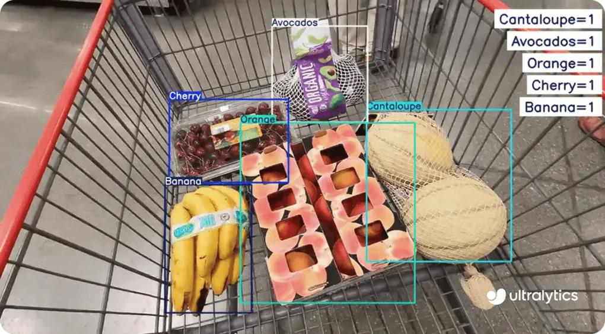

# SmartCart – IoT Smart Shopping Cart with Automated Billing

An academic prototype combining Arduino RFID scanning, a Python Flask billing dashboard, SQLite product storage, and optional OpenCV/YOLO camera object detection.

## Features
- RFID UID registration and product lookup
- Cart quantity and total calculation
- Unknown RFID warning / manual verification path
- Checkout receipt and transaction history
- Arduino UNO + MFRC522 example sketch
- Optional webcam object detection using OpenCV and Ultralytics YOLO

## Architecture
`RFID Tag -> Arduino + RC522 -> Serial UID -> Python backend -> Product database -> Billing dashboard`

The included dashboard supports manual UID entry so you can test the complete billing flow before connecting hardware.

## Requirements
- Python 3.10+
- Arduino UNO/Nano
- MFRC522 RFID reader and compatible RFID tags
- USB cable
- Optional webcam for computer vision

## Run the web billing prototype
### Windows PowerShell
```powershell
cd smartcart_iot_project
py -m venv .venv
.venv\\Scripts\\Activate.ps1
pip install -r requirements.txt
python app.py
```
### Ubuntu / Linux
```bash
cd smartcart_iot_project
python3 -m venv .venv
source .venv/bin/activate
pip install -r requirements.txt
python app.py
```
Open http://127.0.0.1:5000

Demo RFID UIDs seeded in the database:
| UID | Product | Price |
|---|---|---:|
| 8901001 | Milk 500ml | ₹32 |
| 8901002 | Bread | ₹40 |
| 8901003 | Rice 1kg | ₹68 |
| 8901004 | Cooking Oil 1L | ₹145 |
| 8901005 | Biscuits | ₹20 |
| 8901006 | Soap | ₹35 |

For a physical tag, replace these demo UIDs in `PRODUCTS` inside `app.py` with the UID printed by the Arduino Serial Monitor. Restart the app.

## Arduino setup
1. Install the **MFRC522** library in Arduino IDE.
2. Wire RC522 to UNO: SDA/SS D10, RST D9, MOSI D11, MISO D12, SCK D13, 3.3V to 3.3V, GND to GND.
3. Upload `arduino/smartcart_rfid.ino`.
4. Open Serial Monitor at 9600 baud and scan tags.
5. Copy each UID into the product list in `app.py`. For a live integration, run a Python serial reader and POST each received UID to `/api/scan`.

**Electrical caution:** RC522 modules use 3.3V. Do not power the reader from 5V. Use appropriate level shifting where required by your board/module.

## Optional computer vision
```bash
pip install opencv-python ultralytics
python camera_detect.py
```
This uses a general pretrained YOLO model. It can detect common object classes, but it does not identify exact branded products or prove that an RFID scan was missed. For a real retail system, collect and label images of your own products, train a custom detector, and associate detections with a controlled cart-camera workflow.

## API endpoints
- `GET /api/products`
- `GET /api/cart`
- `POST /api/scan` JSON: `{"uid":"8901001"}`
- `POST /api/remove` JSON: `{"uid":"8901001"}`
- `POST /api/clear`
- `POST /api/checkout`
- `GET /api/transactions`

## Database
SQLite is used by default to make the project immediately runnable without installing a database server. For a MySQL deployment, migrate the three tables (`products`, `cart`, `transactions`) and replace the SQLite connection helper with a MySQL connector. Do not claim MySQL/Firebase integration in your resume until you have implemented and tested it.

## Suggested next upgrades
- Live Arduino serial listener using `pyserial`
- MySQL persistence and Firebase synchronization
- Admin page to register products and RFID tags
- Custom YOLO dataset for your product catalogue
- Load cell / IR sensor to detect items physically placed in the cart
- Payment gateway sandbox and authenticated customer sessions

## Project status
This repository is a working educational prototype. Test with real hardware before making performance, queue-reduction, security, or production-readiness claims.

## 📸 Project Screenshots

### 1. SmartCart Dashboard


### 2.Final Bill 


### 3.Basket


### 4.Iot Devices


### 5. Camera Detection


## 🚀 Features

- RFID-based product identification
- Automated billing system
- Python Flask dashboard
- OpenCV object detection prototype
- Product database management
- Transaction history

## 🛠️ Technologies

Python | Arduino | RFID | OpenCV | Flask | SQLite | HTML | CSS | JavaScript
